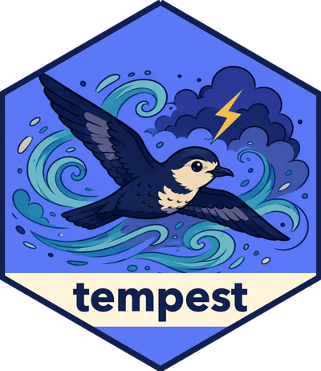

# tempest 

<!-- badges: start -->
[](https://github.com/JamesHWade/tempest/actions/workflows/R-CMD-check.yaml)
[](https://app.codecov.io/gh/JamesHWade/tempest)
<!-- badges: end -->

**Evidence-backed STORM and Co-STORM research agents for R.**

Tempest runs multi-perspective research workflows, verifies claims against exact source quotes, pairs reports with reproducible R analyses, and connects to [graft](https://github.com/JamesHWade/graft) so reviewed findings persist across runs, apps, and MCP clients.

## Installation

```r
# install.packages("pak")
pak::pak("JamesHWade/tempest")
```

## Quick start

### 1. Scripted STORM report

```r
library(tempest)

cfg <- tempest_config(
  models = "openai/gpt-5.6-luna",
  search_provider = "wikipedia"
)

result <- tempest_run(
  "Technical and policy barriers to grid-scale battery recycling",
  config = cfg,
  n_experts = 2,
  max_questions_per_perspective = 2
)

cat(tempest_report(result))
tempest_sources(result)
tempest_claims(result)
tempest_claim_supports(result)
```

### 2. Interactive apps with Graft project memory

Launch the **Researcher app** for research briefs, host R tools, MCP servers, reproducible R analyses, a saved-report library, and explicit Graft review:

```r
tempest_researcher_app(
  output_dir = "research-reports",
  report_library = TRUE,
  graft_store = "research-memory"
)
```

Launch the **Co-STORM workspace** for interactive multi-expert dialogue, a live knowledge map, evidence tables, `shinychat` memory cards, and report publishing:

```r
tempest_app(graft_store = "research-memory")
```

Want to try the full ecosystem locally with **no API keys or network calls**?

```r
tempest_app(demo = TRUE)
```

### 3. Research that remembers with Graft

Every Tempest run produces provisional evidence. When you are ready to keep a finding for future sessions, publish the candidate to a Graft store, review it, and explicitly record acceptance:

```r
store <- graft::graft_store("research-memory", create = TRUE)
selection <- tempest_publish_artifact_research(result, store)

# Review the report and evidence, then explicitly accept into a stream
decision <- graft::graft_accept(
  store,
  graft::graft_read_selection(store, selection),
  stream = "battery-recycling",
  expected = NULL,
  key = "review-1",
  actor = "analyst",
  reason = "Verified claims and primary sources",
  purpose = "research"
)

# Reuse as a pinned basis in a later run (enables structural change detection)
knowledge <- tempest_reuse_artifact_research(
  store,
  stream = "battery-recycling",
  decision = decision@id,
  purpose = "research",
  eligible = function(event) TRUE
)
next_run <- tempest_run("Battery recycling update", knowledge = knowledge)
```

You can also hand `graft::graft_tools(store, purpose = "research", eligible = ...)` to `ellmer`, `deputy`, `tempest_researcher_app()`, `tempest_app()`, or `mcptools::mcp_server()` so agents can discover and recall currently accepted streams on demand.

## Setup

### LLM credentials

Tempest uses [ellmer](https://ellmer.tidyverse.org/) for model access. Set your provider key outside R source files (for example `OPENAI_API_KEY`, `ANTHROPIC_API_KEY`, or `GOOGLE_API_KEY`), or set a personal default model in `.Rprofile`:

```r
options(tempest.chat = "anthropic/claude-sonnet-4-20250514")
```

With the subscription-auth `ellmer` port (`tidyverse/ellmer#1067`), default `openai/` models reuse Codex CLI file-backed authentication (`codex login -c 'cli_auth_credentials_store="file"'`); with released `ellmer` (>= 0.5.0), Tempest uses `OPENAI_API_KEY`.

### Search providers

By default, `tempest_config(search_provider = "native")` uses provider-native web search when supported (OpenAI, Anthropic, Google) and falls back to Wikipedia. Other built-in providers include `"wikipedia"`, `"duckduckgo"`, `"tavily"`, `"brave"`, `"serper"`, `"you"`, `"bing"`, `"searxng"`, `"google"`, and `"azure_ai_search"`—see `?tempest_config` for environment variables. Pass `embed_fn = ragnar::embed_openai()` or `ragnar_store` for semantic retrieval with `ragnar`.

### Optional OpenTelemetry

Tracing is opt-in and disabled by default. To export Tempest-only spans through a local OpenTelemetry Collector (and optionally forward from there to an optional operator-selected destination downstream of the Collector), set these environment variables before starting R and enable `options(tempest.otel.enabled = TRUE)`:

```sh
OTEL_TRACES_EXPORTER=http
OTEL_EXPORTER_OTLP_ENDPOINT=http://127.0.0.1:4318
OTEL_R_EMIT_SCOPES=io.github.jameshwade.tempest
OTEL_INSTRUMENTATION_GENAI_CAPTURE_MESSAGE_CONTENT=false
```

Restricting `OTEL_R_EMIT_SCOPES` to Tempest avoids broad third-party instrumentation across Shiny, Mirai, ellmer, and httr2 (which can otherwise capture raw `url.full` query strings containing secrets such as `GOOGLE_SEARCH_API_KEY`).

## How Tempest fits in the ellmer ecosystem

| Package | Role | How it pairs with Tempest |
|---|---|---|
| **ellmer** & **shinychat** | Model calls, tools, and chat UI | Powers all model roles, Co-STORM chat, and reviewed-memory tool cards |
| **deputy** | Governed agent runtime | Executes moderator and expert turns under explicit tool allowlists |
| **dsprrr** | Typed structured programs | Runs extraction, verification, outline, and writing stages |
| **graft** | Reviewed project memory | Preserves immutable research candidates, host accept/withdraw decisions, and bounded recall tools (`graft_tools()`) |
| **ragnar** | Similarity search (RAG) | Indexes large corpora; pair with Graft so **ragnar finds and graft verifies** |
| **shinymcp** & **mcptools** | MCP Apps & MCP servers | Present read-only research cards (`tempest_mcp_app()`) and serve accepted Graft streams to IDE agents |
| **scans** & **vitals** | Trajectory review & evals | Audit completed runs and `@extra$graft` consultations; evaluate accuracy offline |

## Documentation

- [Get started with Tempest](https://jameshwade.github.io/tempest/articles/tempest.html) — STORM, Co-STORM, experts, configuration, and persistence
- [Enriched reports & the Researcher app](https://jameshwade.github.io/tempest/articles/enriched-research.html) — reproducible R analyses, host tools, MCP servers, and saved libraries
- [Research that remembers with Graft](https://jameshwade.github.io/tempest/articles/research-memory.html) — human review, multi-stream recall, `ragnar` + `graft`, and MCP servers
- [Build a recurring decision briefing](https://jameshwade.github.io/tempest/articles/daily-briefing.html) — structural "what changed" briefings over accepted streams
- [Scientific review and evidence repair](https://jameshwade.github.io/tempest/articles/scientific-review.html) — adversarial claim review, adjudication, and targeted follow-up retrieval
- [Live enriched report example](https://jameshwade.github.io/tempest/live-research/index.html) — inspect a published `datasets::CO2` report with real charts and tables
