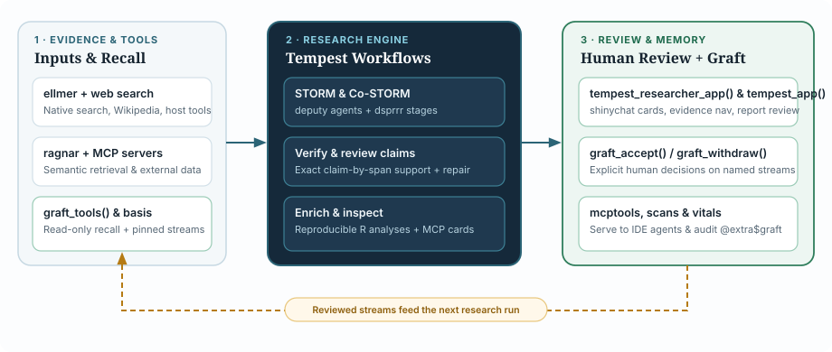

```{r setup, include = FALSE}
knitr::opts_chunk$set(collapse = TRUE, comment = "#>")
```

Most AI research tools forget everything the moment a session closes—or dump
unreviewed model outputs into a vector database where drafts, outdated numbers,
and retracted claims resurface as facts.

Tempest and [graft](https://jameshwade.github.io/graft/) separate those two
jobs cleanly:

- **Tempest** runs provisional research, checks claims against exact source
  quotes, and writes reports.
- **Graft** stores immutable research snapshots, records explicit human review
  decisions (`accept` or `withdraw`) on named streams, and exposes bounded,
  read-only recall to future runs, chats, and external MCP clients.

<figure class="tempest-figure">

<figcaption>Provisional research stays in Tempest until a person explicitly reviews and accepts it into a named Graft stream.</figcaption>
</figure>

## Try the full loop offline

Install the optional packages and launch the bundled offline demonstration. It
runs real `deputy`, `dsprrr`, `shinymcp`, and `graft` code with scripted
replies and synthetic sources—no API keys or network requests required:

```{r demo, eval = FALSE}
pak::pak(c(
  "JamesHWade/tempest",
  "JamesHWade/graft",
  "JamesHWade/shinymcp",
  "shiny",
  "bslib",
  "callr"
))

tempest::tempest_app(demo = TRUE)
```

Walk through the five steps in the sidebar:

1. Inspect the initial 82% recovery report and its exact source quote in the
   **Research card**.
2. Confirm review and click **Accept reviewed research** to record an explicit
   Graft decision.
3. Click **Reopen in a fresh R process** to verify that a new Co-STORM session
   recalls the exact accepted evidence.
4. Click **Research the corrected note** to produce a 74% candidate—notice that
   the accepted 82% result remains active until you review and accept the
   correction.
5. Click **Withdraw retained research** and try reopening again: reuse is
   refused while earlier reports and the full decision history stay inspectable.

Set `options(tempest.demo_dir = "~/tempest-demo")` before launching if you want
the demo store to persist across R sessions.

## Connect Graft to Tempest's apps

Both interactive apps accept an optional `graft_store` argument so teams can
review findings and build on prior work without writing glue code.

### Researcher app

```{r researcher-app, eval = FALSE}
tempest_researcher_app(
  output_dir = "research-reports",
  report_library = TRUE,
  graft_store = "research-memory",
  memory_purpose = "research",
  memory_actor = "alice"
)
```

With `graft_store` configured:

- Every completed run is automatically published to Graft as an **unaccepted
  provisional candidate** (its report, sources, claims, spans, and supports are
  preserved without approving them).
- Open any report to review its evidence, name a stream (or pick an existing
  stream to record a correction), and click **Accept to project memory** or
  **Withdraw from active memory**.
- The **Saved research reports** library displays each report's live Graft
  status (`Accepted`, `Provisional`, `Superseded`, `Withdrawn`) and lets you
  filter to accepted reports.
- Under **Project memory (Graft)** in the sidebar, toggle **"Let experts
  consult reviewed memory"** to attach read-only `graft::graft_tools()` to
  research experts, or pick an accepted stream to compare against.

### Co-STORM workspace

```{r costorm-app, eval = FALSE}
# Local file-backed store (safe across processes via advisory file locks)
tempest_app(graft_store = "research-memory")

# Or pass a PostgreSQL ArtifactStore for multi-user deployments
pg_store <- graft::graft_store_postgres(con, scope = "team-battery")
tempest_app(
  graft_store = pg_store,
  memory_eligible = function(stream) host_user_can_read(current_user, stream)
)
```

In `tempest_app()`:

- **Workspace settings → Project memory (Graft)** lets you toggle read-only
  memory recall for the moderator and experts—rendered inline in chat as
  collapsible `shinychat` tool-result cards—or pin an accepted stream when
  starting a new Co-STORM session.
- **Report → Retain in Graft** publishes a completed Co-STORM or STORM report
  and exposes explicit accept, correct, and withdraw controls alongside
  decision history.
- **Session record → Run review** displays pinned input selections and any
  `@extra$graft` recall consultations recorded during the session.

## Publish, accept, and reuse in R

The installed offline example exercises the same public functions you call on a
live `tempest_run()` or published `tempest_session()`:

```{r offline-example}
library(tempest)
example <- new.env()
sys.source(
  system.file("examples", "artifact-research.R", package = "tempest"),
  example
)
example$artifact_research_example()
```

In your own script or host application, the cycle takes four calls:

```{r programmatic, eval = FALSE}
store <- graft::graft_store("research-memory", create = TRUE)

# 1. Publish completed research as an unaccepted candidate
selection <- tempest_publish_artifact_research(result, store)

# 2. Inspect the candidate report and evidence before deciding
candidate <- tempest_read_artifact_research(store, selection)

# 3. Explicitly accept into a named stream (use expected = prior_decision to correct)
decision <- graft::graft_accept(
  store,
  graft::graft_read_selection(store, selection),
  stream = "battery-recycling",
  expected = NULL,
  key = "review-1",
  actor = "analyst",
  reason = "Verified claims and primary source spans",
  purpose = "research"
)

# 4. Reuse as a pinned basis in a later run
knowledge <- tempest_reuse_artifact_research(
  store,
  stream = "battery-recycling",
  decision = decision@id,
  purpose = "research",
  eligible = function(event) host_can_consult(event)
)
follow_up <- tempest_run("Battery recycling update", knowledge = knowledge)
```

The `eligible` callback runs when `knowledge` is created and again when a run
starts or resumes. If the stream is later corrected or withdrawn, stale
references fail closed rather than silently consulting outdated claims.

### Two ways to consult reviewed memory

Tempest supports two complementary ways to feed reviewed Graft memory into new
research:

1. **Pinned basis (`knowledge = tempest_reuse_artifact_research(...)`)**:
   admits one exact accepted stream's `Claim`, `ClaimSupport`, `EvidenceSpan`,
   and `Source` records as inert evidence. Use this when you want structural
   change detection—comparing new verified claims against previously accepted
   ones (as in [Build a recurring decision briefing](daily-briefing.html)).
2. **Multi-stream agent recall (`graft::graft_tools()`)**: gives an `ellmer` or
   `deputy` agent two read-only tools—`list_project_memory` and
   `recall_project_memory`—bounded by `max_text_bytes` and guarded on every
   call by your `eligible(stream)` callback:

```{r multi-stream-tools, eval = FALSE}
memory_tools <- graft::graft_tools(
  store,
  purpose = "research",
  eligible = function(stream) host_allows_stream(stream)
)
```

### Pairing with ragnar: *ragnar finds, graft verifies*

When your organization accumulates hundreds of reports, pair `ragnar` for broad
semantic search with `graft` for acceptance verification:

1. Index accepted report summaries or claims in a `ragnar` store keyed by their
   Graft `stream` and `decision_id`.
2. Let search locate relevant candidate streams.
3. Pass any search hit through `graft::graft_recall()` or
   `tempest_reuse_artifact_research()` before showing it to a model so
   withdrawn or superseded findings never re-enter a prompt.

## Share over MCP and inspect with scans

### Read-only research cards (`tempest_mcp_app()`)

Turn any completed `tempest_run()` result or published `tempest_session()` into
a read-only `shinymcp` card exposing the report, claim-by-span evidence, and
bounded stage review:

```{r mcp-card, eval = FALSE}
card <- tempest_mcp_app(result)
shinymcp::preview_app(card)
# Or serve in an MCP client:
shinymcp::serve(card)
```

### Serve reviewed memory to IDE agents (`mcptools`)

Because `graft::graft_tools()` returns standard read-only `ellmer::ToolDef`
objects with no model-controlled store handles, you can expose your team's
accepted Tempest research directly to Claude Code, Positron, or Posit
Assistant:

```{r mcp-memory-server, eval = FALSE}
library(graft)

store <- graft_store("/path/to/research-memory")
tools <- graft_tools(
  store,
  purpose = "research",
  eligible = function(stream) TRUE
)

mcptools::mcp_server(tools = tools, session_tools = FALSE)
```

### Audit runs and consultations with `scans`

Every `graft_tool()` and `graft_tools()` call attaches plain-data provenance
under `@extra$graft` (`status`, `stream`, `purpose`, `decision_id`,
`selection_id`, artifact counts, and truncation flags—never live store handles
or raw content). Alongside `tempest_trajectory_review()`, this lets `scans`
inspect both how a run executed and which reviewed streams it consulted:

```{r review-scans, eval = FALSE}
review <- tempest_trajectory_review(
  result,
  store = store,
  selection = selection,
  stream = "battery-recycling",
  decision = decision@id
)
# Export plain validated data for scans
review_data <- tempest_trajectory_review_data(review)
```
